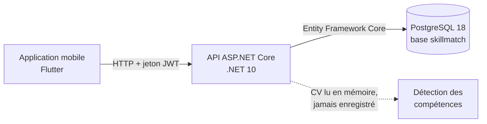

# SkillMatch TN

Application mobile qui lit le CV d'un candidat, repère ses compétences et lui propose des offres d'emploi, de stage et de PFE. Chaque offre affiche un pourcentage de correspondance expliqué, puis des formations pour apprendre les outils qui manquent.

> Le score est une aide pour choisir, pas une garantie d'être retenu.

## Le problème

Un étudiant ou un jeune diplômé ne sait pas toujours quelles offres correspondent vraiment à son profil, ni ce qui lui manque pour les autres. Relire chaque annonce et la comparer à son CV prend du temps, et le résultat reste flou.

## La solution

1. **CV → compétences.** Le candidat envoie son CV (PDF ou DOCX). L'API y repère les outils connus : Flutter, SQL, Docker… Le candidat relit la liste, en retire ou en ajoute.
2. **Compétences → offres.** Chaque offre reçoit un score de 0 à 100 %. Le score est **expliqué** : compétences requises et souhaitées, acquises ou manquantes (en rouge).
3. **Compétences manquantes → formations.** Un appui sur une compétence manquante ouvre des formations pour l'apprendre.

## Captures d'écran

<table>
  <tr>
    <td align="center"><br><sub><b>1. Bienvenue</b> : ce que fait l'application</sub></td>
    <td align="center"><br><sub><b>2. Inscription</b> : nom, e-mail, mot de passe</sub></td>
    <td align="center"><br><sub><b>3. Connexion</b> : compte fictif <code>candidat@exemple.com</code></sub></td>
    <td align="center"><br><sub><b>4. Ajout du CV</b> : PDF ou DOCX, 5 Mo au plus</sub></td>
  </tr>
  <tr>
    <td align="center"><br><sub><b>5. Mes compétences</b> : à relire, retirer ou compléter</sub></td>
    <td align="center"><br><sub><b>6. Offres</b> : score expliqué, manques en rouge</sub></td>
    <td align="center"><br><sub><b>7. Formations</b> : pour une compétence manquante</sub></td>
    <td></td>
  </tr>
</table>

Les captures montrent un compte fictif et les données d'exemple de l'application (voir plus bas).

## Fonctionnalités

- **Compte candidat** : inscription et connexion. Il n'existe qu'un seul type d'utilisateur, le candidat.
- **Analyse du CV** : lecture d'un PDF ou d'un DOCX, puis détection des compétences à partir d'un dictionnaire de près d'une centaine d'outils, chacun avec ses variantes (« NodeJS », « Node.js », « node js »…). Majuscules et accents ne comptent pas, seuls les mots entiers sont reconnus : « Java » n'est pas trouvé dans « JavaScript », ni « Go » dans « Google ».
- **Relecture des compétences** : le candidat garde la main sur la liste détectée.
- **Offres classées** : stage, PFE ou emploi, triées par score puis par date.
- **Formations** : classées par niveau (débutant d'abord), puis par durée.
- **Interface en français.**

### Règle du score

```
score = 70 % × (requises acquises / requises)
      + 30 % × (souhaitées acquises / souhaitées)
```

- Le résultat est **arrondi vers le bas** : on n'affiche jamais 100 % s'il manque une compétence.
- Si l'offre n'a qu'une des deux listes, celle-ci compte pour 100 %.
- La comparaison est souple : « JS » correspond à « JavaScript », « k8s » à « Kubernetes ».

**Exemple de calcul :** l'offre demande 3 compétences requises et 2 souhaitées, et le candidat en a 2 requises et 1 souhaitée.
70 × 2/3 + 30 × 1/2 = 46,67 + 15 = 61,67, arrondi à **61 %**.
L'application affiche aussi la phrase « Requises : 2 sur 3 (70 % du score) · Souhaitées : 1 sur 2 (30 %) ».

Le calcul est fait par l'API, à un seul endroit (`backend/src/SkillMatch.Core/Jobs/MatchScorer.cs`), avec ses tests. L'application affiche le score et l'explication reçus, sans les recalculer.

## Architecture



| Dossier | Rôle |
|---|---|
| `mobile/` | Application Flutter, organisée par fonctionnalité (`auth`, `cv`, `skills`, `offers`, `trainings`) avec un thème et des widgets partagés. |
| `backend/src/SkillMatch.Core` | Règles du métier en fonctions pures : détection des compétences, score, classement. Aucune dépendance. |
| `backend/src/SkillMatch.Infrastructure` | Accès à PostgreSQL et lecture des fichiers PDF et DOCX. |
| `backend/src/SkillMatch.Api` | Routes HTTP : `/auth/register`, `/auth/login`, `/cv`, `/offers`, `/trainings`, `/health`. |
| `backend/tests/SkillMatch.Tests` | Tests xUnit, avec l'API démarrée en mémoire. |
| `design/` | Maquettes des écrans et guide de style. |

**Pourquoi trois projets côté API ?** Le cœur (`Core`) ne connaît ni la base ni le web. Il se teste donc vite et sans serveur, et une source d'offres réelle pourra remplacer les exemples sans toucher au calcul du score.

Le détail de chaque route, des tables et des réglages se trouve dans [`backend/README.md`](backend/README.md).

## Confidentialité et sécurité

- **Le CV est lu puis oublié.** Il est traité en mémoire et n'est écrit ni en base, ni sur le disque, ni dans les journaux. Les journaux de l'analyse ne contiennent que le code de réponse et la durée : jamais de nom de fichier, de texte ni de compétence. Un test automatique le contrôle.
- **Compétences envoyées pour les offres et les formations** : elles ne sont ni enregistrées ni journalisées.
- **Type du fichier** : il est reconnu par ses premiers octets, jamais par l'extension. Les DOCX avec macros sont refusés, et des limites de taille protègent contre les fichiers piégés.
- **Mots de passe** : hachés avec BCrypt, jamais enregistrés en clair.
- **Jeton JWT** : valable 30 minutes, il ne contient que l'identifiant du compte. Sur le téléphone, il est rangé avec `flutter_secure_storage` (Keystore Android, Trousseau iOS).
- **Limitation de débit** : 5 requêtes par minute et par adresse IP sur `/auth/*`, 10 analyses de CV par minute et par compte.
- **Secrets** : aucun mot de passe, aucune clé et aucune chaîne de connexion dans le dépôt. Tout passe par `dotnet user-secrets`, sur la machine du développeur.

## Données d'exemple

> **Les offres et les formations affichées sont des données d'exemple, inventées pour le développement.**
> Elles portent la mention « exemple » dans l'application et `isSample: true` dans l'API. Les entreprises s'appellent « Société Exemple … », les liens pointent vers `example.com`, et les formations d'exemple n'ont pas de lien.
> Elles ne sont importées qu'en environnement de développement. Aucune source réelle d'offres n'est encore branchée.

## Lancer le projet

### Prérequis

- [.NET 10 SDK](https://dotnet.microsoft.com/download)
- [Flutter](https://docs.flutter.dev/get-started/install) (Dart 3.13 ou plus récent)
- PostgreSQL 18, réglé ici sur le **port 3000** (et non 5432)
- Un émulateur Android (ou Chrome pour la version web)

### 1. Base de données

Créez la base `skillmatch` avec un rôle qui en est propriétaire (les valeurs entre chevrons sont à remplacer) :

```sql
CREATE DATABASE skillmatch OWNER <role>;
```

### 2. Secrets (dotnet user-secrets)

Depuis `backend/`, remplacez **toutes** les valeurs entre chevrons. Elles sont rangées hors du dépôt, sur votre machine.

```
dotnet user-secrets set "ConnectionStrings:SkillMatch" "Host=localhost;Port=3000;Database=skillmatch;Username=<utilisateur>;Password=<mot_de_passe>" --project src/SkillMatch.Api
dotnet user-secrets set "Jwt:SigningKey" "<CLE_ALEATOIRE_DE_64_OCTETS_EN_BASE64>" --project src/SkillMatch.Api
```

Pour générer la clé dans PowerShell :

```powershell
$b = New-Object byte[] 64; [Security.Cryptography.RandomNumberGenerator]::Create().GetBytes($b); [Convert]::ToBase64String($b)
```

La commande `set` reste dans l'historique de PowerShell : vous pouvez l'effacer ensuite.

### 3. Tables

Depuis `backend/` :

```
dotnet tool restore
dotnet ef database update --project src/SkillMatch.Infrastructure --startup-project src/SkillMatch.Api
```

### 4. API

Depuis `backend/` :

```
dotnet run --project src/SkillMatch.Api
```

L'API écoute sur `http://localhost:5080`. Ouvrez `http://localhost:5080/health` : la réponse attendue est `{"status":"ok"}`. Au premier démarrage, les offres et les formations d'exemple sont importées, et relancer l'API ne crée pas de doublon.

### 5. Application mobile

Depuis `mobile/` :

```
flutter pub get
flutter run --dart-define=API_URL=http://10.0.2.2:5080
```

Pourquoi `10.0.2.2` ? Dans l'émulateur Android, `localhost` désigne l'émulateur lui-même. `10.0.2.2` est l'adresse que l'émulateur donne à l'ordinateur qui le fait tourner. Dans Chrome, utilisez `API_URL=http://localhost:5080`.

### 6. Tests

```
cd backend
dotnet test

cd mobile
flutter test
```

`dotnet test` n'a pas besoin de PostgreSQL : les tests utilisent une base SQLite en mémoire et une clé de jeton tirée au hasard. Les CV de test sont fabriqués pendant les tests, avec un texte fictif.

## Limites connues et prochaines étapes

- **Vraies offres** : brancher une source réelle d'offres et de formations. Le code est prêt pour cela (`IJobSource`, `ITrainingSource`), mais seules les sources d'exemple existent.
- **HTTPS avant tout déploiement** : en local, l'API tourne en `http` et le CV circule en clair sur la machine. C'est acceptable pour développer, pas pour un vrai déploiement.
- **CV scannés** : un CV qui n'est qu'une image n'est pas lu, car il n'y a pas de reconnaissance de texte (OCR).
- **Dictionnaire** : une compétence absente du dictionnaire n'est pas détectée. Le candidat peut l'ajouter à la main.
- **Session** : le jeton dure 30 minutes, sans renouvellement automatique.
- **Volume** : les offres sont notées en mémoire, ce qui suffit pour quelques centaines. Avec une grande source, il faudra filtrer d'abord en SQL.

## Auteur

**Lazher Ben Massaoud**, UAS Tunis.

## Licence

Projet étudiant, UAS Tunis, tous droits réservés.
